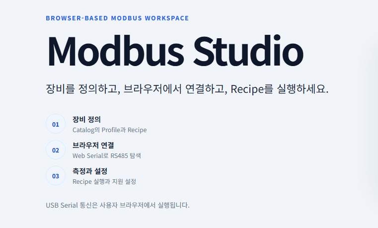
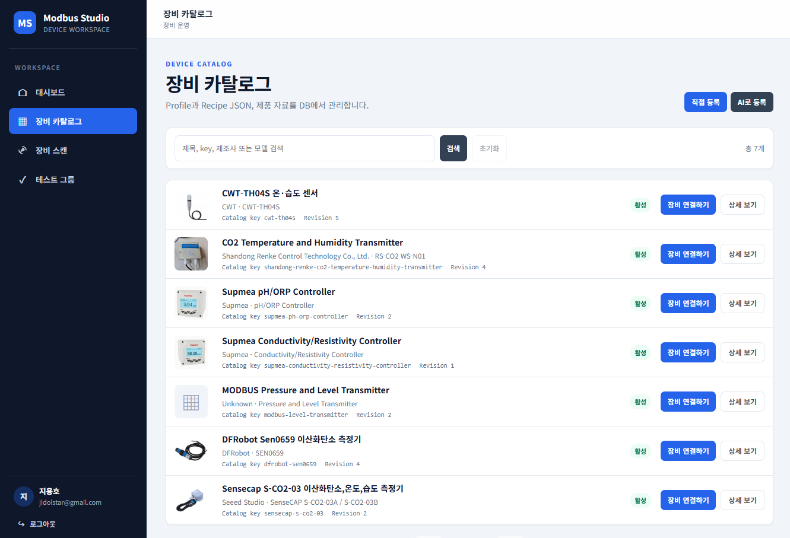
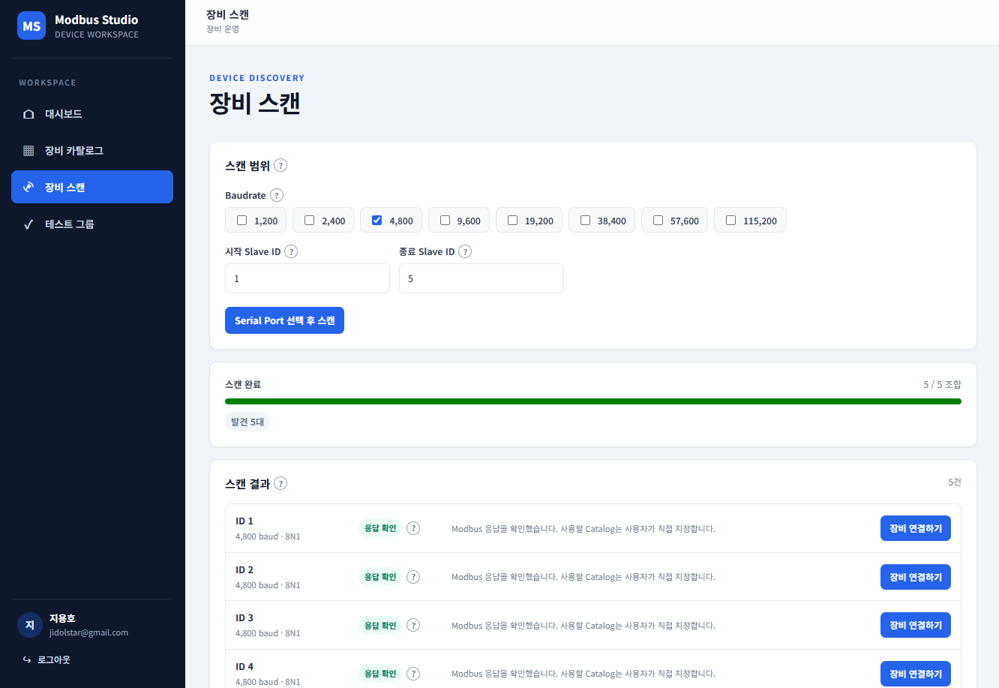
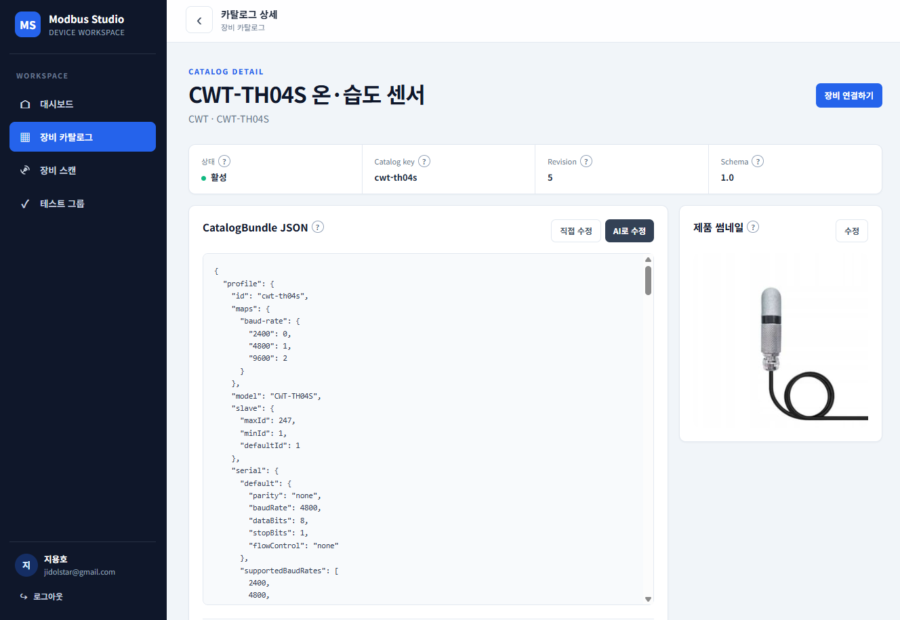
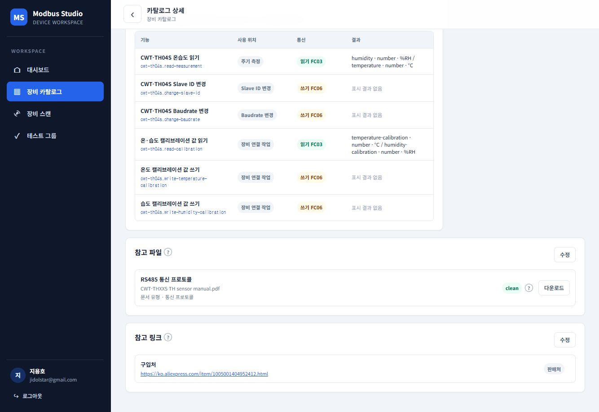
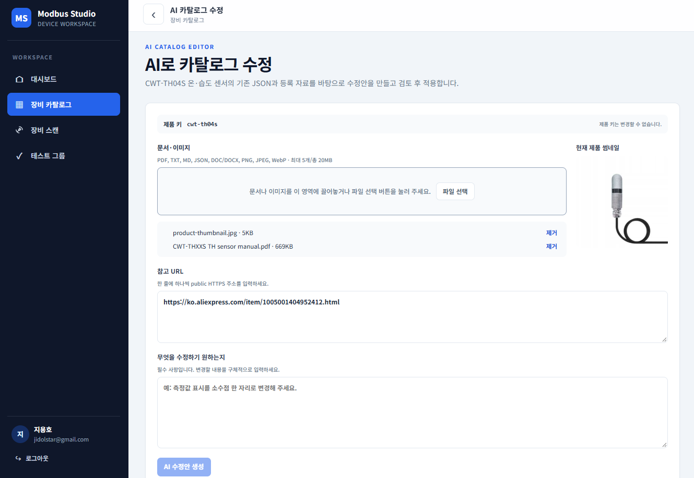
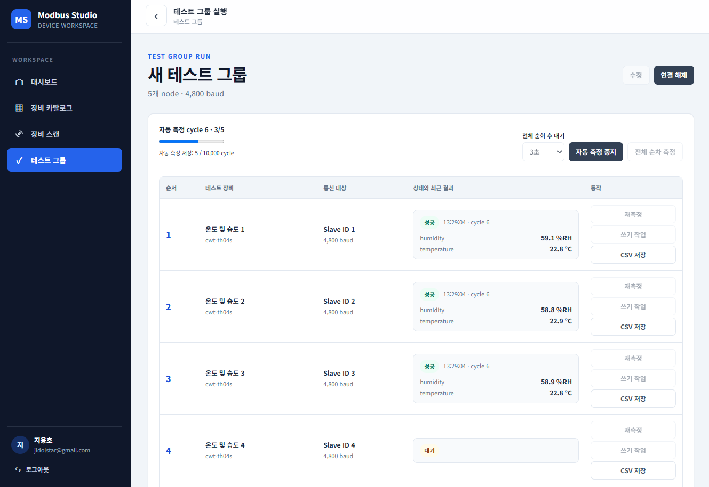

# Modbus Studio



Modbus Studio는 브라우저에서 Modbus RTU 장비를 정의하고 연결해 실행하는 작업 공간입니다. 관리자는 장비 Catalog의 Profile과 Recipe를 관리하고, 사용자는 지원되는 브라우저에서 Web Serial로 RS485 장비를 탐색·측정·설정합니다.

**개발자: Ji Yong ho**

장비별 동작 차이는 실행 엔진이 지원하는 Step과 decoder 범위에서 JSON Profile/Recipe로 표현합니다. 실제 장비에 필요한 프로토콜 능력이 현재 엔진에 없을 때만 엔진을 확장합니다.

현재 구현 범위는 CWT-TH04S 온습도 센서의 측정, Catalog 기반 장비 탐색, Slave ID/baudrate 변경, 관리용 Test Group 저장·실행입니다. Catalog 관리에는 JSON 검증, 활성/비활성 상태, 300×300 JPEG 썸네일, 참고 파일과 HTTPS 링크가 포함됩니다. 선택 기능인 AI Catalog 작성·수정은 Gemini API를 사용하며, 생성된 제안은 검토·승인 후 저장됩니다.

## 주요 화면

### 장비 카탈로그

Catalog 목록에서 등록된 장비를 검색하고, 장비 연결이나 상세 정보를 열 수 있습니다.



### 장비 스캔

지원 baudrate와 Slave ID 범위를 지정해 연결된 RS485 장비를 탐색합니다.



### 카탈로그 상세와 Recipe

제품 상세에서 Profile JSON, 썸네일, 지원 작업 Recipe와 참고 자료를 확인합니다.





### AI 카탈로그 수정

기존 Catalog와 참고 자료를 바탕으로 AI 수정안을 만들고 검토합니다. 제안은 승인 후 적용됩니다.



### 테스트 그룹 실행

여러 장비의 측정 결과와 실행 상태를 한 화면에서 확인합니다.



## 설계 원칙

```text
Browser / Frontend
  ├─ Web Serial 연결과 연결 상태 관리
  ├─ Modbus RTU frame 및 transaction
  ├─ Profile/Recipe 검증과 실행
  ├─ 측정, 장비 Scan, Slave ID/baudrate 설정
  └─ Test Group 실행과 결과 표시

Backend
  ├─ Google 인증과 서버 관리형 세션
  ├─ Catalog JSON 검증·관리 API와 runtime snapshot
  ├─ Test Group 저장·실행 snapshot API
  ├─ 썸네일·참고 파일·HTTPS 링크 관리
  └─ MySQL 영속화와 migration

MySQL
  └─ 사용자, 세션, Catalog, 참고 자료 metadata와 Test Group
```

USB Serial 통신은 사용자의 브라우저에서 실행됩니다. Docker container나 Backend에 USB 장치를 전달하지 않습니다.

## 저장소 구조

```text
.
├─ frontend/
│  ├─ src/serial/           Web Serial transport와 연결 생명주기
│  ├─ src/modbus/           RTU codec, client와 transaction queue
│  ├─ src/device-catalog/   API Catalog, Profile/Recipe contract와 검증
│  ├─ src/recipe-engine/    제한된 Recipe 실행기
│  ├─ src/application/      측정, Scan과 장비 설정 workflow
│  └─ src/test-fixtures/device-catalog 테스트 전용 Profile/Recipe JSON
├─ backend/                 NestJS/Fastify API 기반
├─ common/                  양쪽에서 사용하는 공개 Catalog 계약과 Schema
├─ docker/
│  ├─ dev/                  개발용 Compose, Dockerfile과 run.bat
│  └─ prod/                 운영용 Compose, Dockerfile, nginx 설정과 운영 스크립트
├─ .agents/skills/          저장소 전용 Codex/agent 작업 지침
├─ AGENTS.md                공통 개발 원칙
└─ .env.sample              공개 가능한 환경변수 예제
```

## 실행 환경

- Node.js 22와 npm
- Docker Compose 및 외부 Docker network `shared-net`
- 앱 데이터베이스로 사용할 MySQL 8.4 인스턴스. 데이터베이스는 이 Compose에서 생성하지 않습니다.
- Google 로그인을 사용할 경우 OpenID Connect 앱 설정과 허용할 이메일 주소
- Web Serial 사용 시 HTTPS 배포 또는 localhost와 지원 브라우저(Chrome/Edge 계열)

USB Serial 포트는 사용자 브라우저에서만 접근합니다. Backend와 Docker에는 장비 USB를 연결하지 않습니다.

## 시작

### DB와 `.env` 준비

먼저 공개 예제 설정을 루트 `.env`로 복사하고 실제 값으로 바꿉니다. `.env`에는 비밀번호와 secret이 있으므로 Git에 커밋하지 않습니다.

```powershell
Copy-Item .env.sample .env
```

MySQL 8.4 서버와 애플리케이션이 사용할 데이터베이스는 먼저 준비해야 합니다. 이 프로젝트는 MySQL 서버나 데이터베이스 자체를 만들지 않습니다. 새 데이터베이스는 테이블이 없는 빈 상태로 두면 Backend migration이 테이블을 생성하고 버전을 기록합니다. `docker/prod/run.sh`와 `restart.sh`는 배포 후 migration을 실행하며 Backend도 시작 시 미적용 migration을 적용합니다.

MySQL 관리 계정으로 데이터베이스와 애플리케이션 계정을 준비하는 예시는 다음과 같습니다. 비밀번호는 임의의 강한 값으로 바꾸고, `'%'` 접속 host는 가능한 앱 서버의 실제 네트워크 범위로 제한합니다. MySQL 포트도 인터넷에 공개하지 말고 앱 서버에서만 접근 가능하게 설정합니다.

```sql
CREATE DATABASE IF NOT EXISTS modbus_manager
  CHARACTER SET utf8mb4
  COLLATE utf8mb4_0900_ai_ci;

CREATE USER 'modbus_app'@'%' IDENTIFIED BY 'replace_with_a_long_random_password';
GRANT ALL PRIVILEGES ON modbus_manager.* TO 'modbus_app'@'%';
```

계정은 해당 데이터베이스 범위에서 앱의 읽기·쓰기와 migration의 테이블·인덱스 생성 및 변경을 할 수 있어야 합니다. 앱 테이블을 수동으로 만들지 마세요. 테이블을 미리 만든 DB에는 migration이 자동으로 적용·인식되지 않아 `table already exists` 오류가 날 수 있습니다. 이미 운영 중인 데이터가 있으면 백업한 뒤 현재 schema와 migration 이력을 확인하고 적용해야 합니다. 실행된 migration은 `kysely_migration` 이력 테이블에 기록됩니다.

루트 `.env`에서 최소한 다음 값을 설정합니다. 도메인은 예시이므로 실제 Frontend/API 주소로 교체합니다. Docker 개발 Compose와 운영 Compose는 이 파일을 Backend runtime 설정으로 사용합니다. 개발 Compose는 Frontend에도 전달하며, 운영 Compose는 Frontend 빌드에 공개 가능한 `VITE_*` 설정과 `CORS_ORIGIN`만 전달합니다.

```dotenv
NODE_ENV=development
PORT=3000
CORS_ORIGIN=https://app.example.com
VITE_API_BASE_URL=https://api.example.com/api
VITE_ALLOWED_HOSTS=app.example.com

GOOGLE_OIDC_CLIENT_ID=your-client-id.apps.googleusercontent.com
GOOGLE_OIDC_CLIENT_SECRET=replace_with_secret
GOOGLE_OIDC_CALLBACK_URL=https://api.example.com/api/auth/google/callback
AUTH_ALLOWED_EMAILS=admin@example.com

JWT_SECRET=replace_with_at_least_32_random_bytes
AUTH_SESSION_TTL_SECONDS=28800
AUTH_COOKIE_NAME=modbus_session

DATABASE_HOST=mysql-8.4
DATABASE_PORT=3306
DATABASE_NAME=modbus_manager
DATABASE_USER=modbus_app
DATABASE_PASSWORD=replace_with_a_long_random_password
DATABASE_SSL=false
```

- `DATABASE_HOST`는 Backend 컨테이너에서 접근 가능한 MySQL 주소입니다. 다른 컨테이너라면 `shared-net`에 연결하고 그 네트워크에서 해석되는 컨테이너 이름을 사용합니다. `localhost`는 Backend 컨테이너 자신을 가리킵니다.
- `CORS_ORIGIN`은 Frontend의 공개 origin으로, 경로와 마지막 `/` 없이 입력합니다. 인증 redirect, CORS, HTTPS canonical/Open Graph 주소에 사용됩니다. 운영에서는 HTTPS여야 합니다.
- `VITE_API_BASE_URL`은 브라우저가 접근하는 API base URL이며 `/api`를 포함합니다. `VITE_ALLOWED_HOSTS`는 Vite 개발 서버 허용 host 목록입니다. 두 `VITE_*` 값은 브라우저에 공개되므로 secret을 넣지 않습니다.
- Google 로그인을 사용하려면 OIDC client ID/secret, callback URL, 허용 이메일 목록을 설정하고 callback URL을 Google 앱 설정에도 동일하게 등록합니다. `JWT_SECRET`은 최소 32바이트의 무작위 secret으로 설정합니다. `.env.sample`의 예시 값을 운영에서 그대로 사용하지 않습니다.
- `AUTH_SESSION_TTL_SECONDS`는 300~86400초 범위입니다. `AUTH_COOKIE_NAME`은 세션 cookie 이름입니다.
- `CATALOG_UPLOAD_ROOT`와 `CATALOG_FILE_MAX_BYTES`, `CATALOG_THUMBNAIL_MAX_BYTES`는 업로드 위치와 크기 제한이며 생략하면 `.env.sample`의 기본값을 사용합니다. Compose named volume은 기본 경로를 보존합니다.
- `GEMINI_API_KEY`는 선택 설정이며 Backend에서만 사용합니다. AI Catalog 기능이 필요할 때 실제 key를 `.env`에 넣고 Frontend 변수에는 넣지 않습니다. `GEMINI_CATALOG_MODEL`, `GEMINI_CATALOG_TIMEOUT_MS`, `GEMINI_AUDIT_RETENTION_DAYS`에는 기본값이 있습니다.

`NODE_ENV`는 `.env.sample`에서 개발 기본값으로 제공됩니다. 운영 Compose는 Backend의 `NODE_ENV`를 `production`으로 지정하지만, 운영 환경 문서와 설정 일관성을 위해 `.env`에도 `production`을 기록하는 것을 권장합니다. 전체 환경변수와 기본값은 [`.env.sample`](.env.sample)을 기준으로 확인합니다.

### Docker 개발 환경 (Windows)

MySQL 서버와 앱 데이터베이스를 먼저 준비하고 Backend 컨테이너에서 접근할 수 있도록 `DATABASE_HOST`를 설정합니다. 이 프로젝트의 Compose는 MySQL을 생성하지 않습니다. `docker\dev\run.bat`은 Docker의 외부 `shared-net` 네트워크를 준비하고 Backend와 Frontend 개발 컨테이너를 시작합니다.

개발 Compose는 호스트 포트를 공개하지 않습니다. 브라우저에서 사용하려면 `shared-net`에 연결된 reverse proxy를 통해 Frontend를 제공해야 합니다. `VITE_API_BASE_URL`은 브라우저가 접근할 수 있는 API 주소로, `CORS_ORIGIN`은 사용자가 접속하는 Frontend의 정확한 origin으로 지정합니다.

```powershell
docker\dev\run.bat
```

컨테이너 네트워크 안에서 Frontend와 Backend는 다음 주소로 접근할 수 있습니다.

- Frontend container: `http://modbus-frontend:5173`
- Backend health: `http://modbus-backend:3000/api/health`
- 외부 주소는 Cloudflare Tunnel 등 reverse proxy에서 위 컨테이너 주소로 연결합니다.

### Node.js 직접 실행

Docker 대신 로컬에서 각 서버를 실행할 수도 있습니다. root `.env`에서 브라우저 기준 API 주소와 origin을 로컬 주소로 설정합니다. 예를 들어 Frontend는 `http://localhost:5173`, Backend API는 `http://localhost:3000/api`를 사용합니다.

```dotenv
VITE_API_BASE_URL=http://localhost:3000/api
VITE_ALLOWED_HOSTS=localhost
CORS_ORIGIN=http://localhost:5173
```

Vite는 저장소 루트의 `.env`를 읽지만 Backend는 자동으로 `.env`를 읽지 않습니다. Backend 실행 명령에 Node.js의 `--env-file` 옵션을 사용해 환경변수를 전달합니다. 두 서버 모두 DB가 필요하므로, 직접 실행할 때는 `DATABASE_HOST`도 호스트에서 접근 가능한 주소(예: `localhost`)로 바꿉니다. Google 로그인이나 AI Catalog 기능을 쓸 때는 해당 설정도 준비해야 합니다. 로컬에서 Google 로그인을 쓰려면 OIDC callback URL도 `http://localhost:3000/api/auth/google/callback`으로 설정하고 Google 앱 설정에 동일하게 등록합니다.

각 프로젝트 디렉터리에서 의존성을 설치하고 아래 개발 명령을 실행합니다.

```powershell
cd frontend
npm ci
npm run dev
npm run typecheck
npm test
npm run build
```

Backend는 별도 터미널에서 실행합니다. 마지막 줄은 저장소 루트 `.env`를 읽어 Backend 개발 서버를 시작합니다.

```powershell
cd backend
npm ci
node --env-file=../.env ./node_modules/@nestjs/cli/bin/nest.js start --watch
npm run typecheck
npm test
npm run build
```

## 개발 명령

```powershell
docker compose -f docker/dev/docker-compose.yml exec backend npm run db:migrate
docker compose -f docker/dev/docker-compose.yml logs -f frontend backend
docker compose -f docker/dev/docker-compose.yml down
```

### EC2 운영 배포

개발 및 운영 Docker 파일은 `docker/dev`와 `docker/prod` 아래에 각각 모았습니다. 이 절차는 Ubuntu 24.04 EC2에서 호스트 nginx가 TLS와 도메인 라우팅을 맡고, Docker Compose가 Frontend와 Backend를 실행하는 배포를 설명합니다.

#### 1. Docker와 Compose 설치

Ubuntu 패키지로 Docker와 Compose plugin을 설치하고 daemon을 활성화합니다. Ubuntu 제공 패키지를 사용하는 방법은 [Ubuntu Docker 안내](https://ubuntu.com/server/docs/how-to/containers/docker-for-system-admins/)를 참고하세요.

```bash
sudo apt update
sudo apt install -y docker.io docker-compose-v2 git
sudo systemctl enable --now docker
docker --version
docker compose version
```

`docker`를 `sudo` 없이 실행하려면 EC2 로그인 계정을 Docker 그룹에 추가한 뒤 SSH에서 로그아웃하고 다시 접속합니다.

```bash
sudo usermod -aG docker "$USER"
```

#### 2. 저장소와 운영 환경 설정

Public 저장소를 clone하고 root `.env`를 만듭니다. 인증 정보와 운영 도메인이 포함되는 `.env`는 Git에 커밋하지 않습니다.

```bash
sudo install -d -o "$USER" -g "$USER" /var/www/modbus
git clone https://github.com/jidolstar/modbus-web-serial-runtime.git /var/www/modbus
cd /var/www/modbus
cp .env.sample .env
nano .env
```

최소한 아래 공개 URL을 실제 도메인으로 설정합니다. API base URL에는 `/api`가 포함되어야 합니다. Google OIDC callback, DB 연결, allowlist와 secret 값도 실제 운영 설정으로 바꿉니다.

```dotenv
VITE_API_BASE_URL=https://modbus-api.example.com/api
CORS_ORIGIN=https://modbus.example.com
GOOGLE_OIDC_CALLBACK_URL=https://modbus-api.example.com/api/auth/google/callback
```

`docker/prod/run.sh`는 Compose에 root `.env` 경로를 직접 전달하고 `shared-net`이 없으면 생성합니다. 따라서 외부 MySQL 컨테이너가 같은 네트워크를 사용하도록 연결되어 있어야 합니다. MySQL이 EC2 호스트에서 실행된다면 Docker bridge에서 접속 가능한 주소를 `DATABASE_HOST`에 설정해야 합니다.

```bash
./docker/prod/run.sh
```

이 명령은 production 이미지를 빌드하고 Frontend/Backend를 시작한 뒤 Backend의 컴파일된 DB migration을 실행합니다. Frontend와 Backend는 호스트의 `127.0.0.1:5173`, `127.0.0.1:3000`에만 바인딩됩니다. 호스트 nginx는 Docker network에 연결하지 않고 이 loopback 포트로 proxy합니다. `shared-net`은 컨테이너와 외부 DB 컨테이너 간 통신에 사용합니다.

#### 3. 호스트 nginx vhost

Ubuntu nginx 사이트 설정은 `/etc/nginx/sites-available/`에 저장하고 `/etc/nginx/sites-enabled/`에서 활성화합니다. 아래 예시의 두 도메인을 실제 도메인으로 바꿉니다. 한 vhost 파일을 `sites-enabled`에 한 번만 연결해야 하며, 같은 server block을 복사하거나 같은 설정을 다른 파일명으로 중복 활성화하면 `conflicting server name` 경고가 발생합니다.

```nginx
server {
    listen 80;
    server_name modbus.example.com;
    client_max_body_size 60m;

    location / {
        proxy_pass http://127.0.0.1:5173;
        proxy_http_version 1.1;
        proxy_set_header Host $host;
        proxy_set_header X-Real-IP $remote_addr;
        proxy_set_header X-Forwarded-For $proxy_add_x_forwarded_for;
        proxy_set_header X-Forwarded-Proto $scheme;
    }
}

server {
    listen 80;
    server_name modbus-api.example.com;
    client_max_body_size 60m;

    location / {
        proxy_pass http://127.0.0.1:3000;
        proxy_http_version 1.1;
        proxy_set_header Host $host;
        proxy_set_header X-Real-IP $remote_addr;
        proxy_set_header X-Forwarded-For $proxy_add_x_forwarded_for;
        proxy_set_header X-Forwarded-Proto $scheme;
        # Gemini 요청 timeout은 최대 5분이므로 proxy 기본 timeout보다 길게 설정한다.
        proxy_connect_timeout 10s;
        proxy_send_timeout 310s;
        proxy_read_timeout 310s;
    }
}
```

도메인의 A 레코드가 EC2 공인 IP를 가리키고, EC2 Security Group에서 TCP 80과 443 inbound가 허용되어야 합니다. 사이트 설정을 활성화하고 검사한 뒤 nginx를 reload합니다.

```bash
sudo ln -s /etc/nginx/sites-available/modbus.example.com /etc/nginx/sites-enabled/modbus.example.com
sudo nginx -t
sudo systemctl reload nginx
```

`sites-enabled`에 잘못된 이름의 링크나 중복 링크가 있는지 확인합니다. 같은 설정이 두 경로에서 활성화되어 있으면 duplicate warning이 나며, 오타 링크만 제거하고 올바른 설정 하나를 남깁니다.

```bash
sudo ls -la /etc/nginx/sites-enabled/
sudo grep -RInE 'server_name.*(modbus\.example\.com|modbus-api\.example\.com)' /etc/nginx/sites-enabled /etc/nginx/conf.d
```

#### 4. HTTPS와 인증서 자동 갱신

인증서 발급 전 DNS와 HTTP proxy가 정상인지 확인하고, EC2에서 포트 80과 443이 외부에 열려 있는지 확인합니다. Certbot nginx plugin으로 두 도메인 인증서를 발급합니다.

```bash
sudo certbot --nginx -d modbus.example.com -d modbus-api.example.com
sudo nginx -t
sudo systemctl reload nginx
```

HTTP를 HTTPS로 redirect하도록 선택합니다. Ubuntu의 [Certbot 안내](https://ubuntu.com/server/docs/how-to/security/obtain-tls-certificates/)를 참고하세요. Ubuntu 패키지의 Certbot timer가 활성화되어 있는지 확인하고 갱신을 시험합니다.

```bash
systemctl list-timers --all | grep -i certbot
sudo certbot renew --dry-run
```

자동 갱신을 위해 포트 80과 두 도메인의 DNS가 계속 유지되어야 합니다. Certbot nginx plugin은 인증서 갱신이 성공하면 nginx를 자동 reload합니다.

#### 배포와 운영 명령

코드 반영은 원하는 tag 또는 commit으로 직접 선택합니다. `run.sh`와 `restart.sh`는 Git pull을 실행하지 않습니다. 저장소 루트에서 pull한 다음 운영 재배포 스크립트를 실행합니다.

```bash
git pull --ff-only
./docker/prod/restart.sh
```

운영 로그 확인과 중지는 아래 스크립트를 사용합니다.

```bash
./docker/prod/logs.sh
./docker/prod/stop.sh
```

`stop.sh`는 컨테이너만 중지·제거하며 Catalog 업로드 named volume은 보존합니다. 업로드와 외부 MySQL은 서버 백업에 포함해야 합니다. EC2 Security Group에는 SSH와 nginx용 80/443만 공개하고 Docker 앱 포트 3000/5173은 공개하지 않습니다.

Backend는 Google 인증 설정이 없어도 구성 상태를 Frontend에 표시할 수 있지만 로그인하려면 OIDC 설정이 필요합니다. 개발 Compose는 소스를 bind mount해 변경을 감지합니다. 운영 Compose는 정적 Frontend와 빌드된 Backend를 사용합니다. 두 Compose 모두 MySQL을 생성하지 않으며 외부 MySQL을 `shared-net`에서 사용합니다.

Catalog 첨부 파일은 `catalog_uploads` named volume에 저장됩니다. 해당 volume은 Backend에만 연결되며 Frontend web root에서는 직접 접근할 수 없습니다. Compose의 `down` 명령은 named volume을 삭제하지 않습니다.

AI 작성·수정은 Backend의 `GEMINI_API_KEY`가 있을 때 사용할 수 있습니다. 키는 Backend에만 보관하며 Frontend로 전달하지 않습니다. 제안은 Catalog에 자동 반영되지 않고 관리자가 검토·승인해야 합니다. Gemini 모델·timeout·감사 기록 보존 기간은 `.env.sample`의 `GEMINI_*` 설정으로 조정할 수 있습니다.

## 장비 등록

장비는 `CatalogBundle v1` JSON으로 표현합니다. Backend가 Schema와 참조를 검증해 DB에 저장하고, Frontend는 인증된 runtime snapshot에서 활성 Catalog를 읽습니다. Profile/Recipe 범위와 공유 Schema는 [device-catalog-domain](common/device-catalog-domain/)에서 확인할 수 있습니다. `frontend/src/test-fixtures/`의 Catalog JSON은 테스트 전용 예시이며 실제 runtime source가 아닙니다.

## 검증

Frontend 테스트는 Web Serial과 장비를 모의해 실행합니다. 실제 통신은 HTTPS 또는 localhost의 지원 브라우저와 연결된 RS485 장비가 있어야 확인할 수 있습니다. 장비 연결·측정·설정 시 포트 권한, Slave ID, baudrate, parity와 배선을 확인합니다.

## 개발 원칙

기여하거나 자동화 도구로 코드를 변경할 때는 [AGENTS.md](AGENTS.md)를 먼저 확인합니다. 구현은 현재 요구사항을 해결하는 범위에서 짧고 명확하게 유지하며, 프로젝트 목적과 무관한 기능이나 추상화를 추가하지 않습니다.

실제 환경변수, 인증정보, 회사 내부 문서와 임시 파일은 공개 저장소에 포함하지 않습니다.

## 라이선스

Apache License 2.0을 적용합니다. 자세한 내용은 [LICENSE](LICENSE)를 확인하세요.
